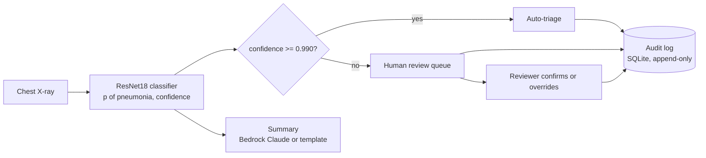

# Chest X-ray Triage Demo


**Status:** working local demo. Runs on a laptop CPU. Not deployed. **Decision support only, not a diagnosis.**

## What it does

1. Scores a chest X-ray with a small fine-tuned image model and returns the probability of pneumonia
   plus a confidence score.
2. Routes the case by confidence. Cases at or above a measured threshold go to auto-triage. The rest
   go to a human review queue.
3. Writes a two-sentence summary of the model's output. Claude on Amazon Bedrock writes it when
   enabled; otherwise a fixed template does. The LLM only sees the model's numbers and route,
   never the image.
4. Labels every result "Decision support only, not a diagnosis."
5. Logs every prediction and every reviewer decision to an append-only audit log (case ID, model
   version, score, route, reviewer action, time).
6. Shows all of this in a Streamlit app with four tabs: triage a case, review queue, audit log and
   model evaluation.

The model and data are for demonstration. The images are pediatric chest X-rays from a public
research dataset, downsized to 64x64.

## Screenshots

| Auto-triage | Sent to human review |
|---|---|
|  |  |

| Review queue | Audit log |
|---|---|
|  |  |


## Architecture



| Piece | File | Notes |
|---|---|---|
| Model | `triage/model.py` | torchvision ResNet18, ImageNet weights, one output logit |
| Training and evaluation | `triage/train.py` | CPU only, writes `artifacts/` |
| Routing | `triage/routing.py` | threshold choice and per-lane report |
| Audit log | `triage/audit.py` | every event is a new row; nothing is updated in place |
| Summary | `triage/summary.py` | Bedrock call, template fallback, per-call cost log |
| App | `app.py` | Streamlit |

The trained weights (`artifacts/model.pt`, 22 MB) and 32 test images (`samples/`) are in the repo,
so the app and tests run without downloading the dataset.

## How to run

Python 3.11. PyTorch 2.2.2 is pinned because it is the last version with Intel Mac wheels.

```bash
python -m venv .venv && source .venv/bin/activate
pip install -r requirements-dev.txt --extra-index-url https://download.pytorch.org/whl/cpu
streamlit run app.py
pytest
```

LLM summaries (optional, needs AWS credentials with Bedrock access):

```bash
export TRIAGE_USE_BEDROCK=1
export EXPECTED_AWS_ACCOUNT=123456789012   # optional: refuse to call AWS from any other account
export TRIAGE_BEDROCK_MODEL=us.anthropic.claude-sonnet-4-6   # default
streamlit run app.py
```

Each summary uses about 160 input and 70 output tokens, roughly $0.0015 per case. Calls are logged
to `llm_cost_log.csv`.

Retrain and re-evaluate (downloads PneumoniaMNIST, about 20 MB; took 34 minutes on a 2-core laptop):

```bash
pip install -r requirements-train.txt --extra-index-url https://download.pytorch.org/whl/cpu
python -m triage.train --epochs 6
python -m triage.model_card
```

## Measured results

Held-out set: PneumoniaMNIST official test split, 624 images (234 normal, 390 pneumonia).
Full details are in [MODEL_CARD.md](MODEL_CARD.md) and `artifacts/metrics.json`.

| Metric | Value |
|---|---|
| Accuracy | 0.921 |
| Precision (pneumonia) | 0.892 |
| Recall (pneumonia) | 0.995 |
| Specificity | 0.799 |
| ROC AUC | 0.982 |

Confusion matrix (rows are the truth): normal 187 correct, 47 called pneumonia; pneumonia 388
correct, 2 called normal.

Routing: the threshold (0.990) was picked on a stratified half of the test split as the lowest
confidence with at least 98% accuracy on auto-triaged cases. On the other half, which played no
part in picking it:

| Lane | Share of cases | Accuracy | Missed pneumonia |
|---|---|---|---|
| Auto-triage | 76.9% | 97.9% | 0 |
| Human review | 23.1% | 73.6% | 0 |

A threshold picked on the validation split instead would have been 0.553 and auto-triaged 98% of
cases at 92.8% accuracy, because PneumoniaMNIST's validation split is easier than its test split.

Tests: 20 pytest tests (routing, audit log, summary with a fake Bedrock client, model inference on
the bundled images, and a Streamlit UI run). CI also scans the full git history with gitleaks.

## Data and licenses

- PneumoniaMNIST (MedMNIST v2), CC BY 4.0. Source images from Kermany et al., Cell 2018, CC BY 4.0.
  Attribution in [samples/README.md](samples/README.md).
- ImageNet-pretrained ResNet18 weights from torchvision.
- Code: MIT, see [LICENSE](LICENSE).

## What's planned

- Probability calibration (temperature scaling) so confidence is closer to real accuracy.
- Higher resolution input (128 or 224) and a comparison against the 64x64 model.
- Reviewer identity from a login instead of a free-text name.
- A container image and a deploy target, once the above is done.

## Repository notes

`legacy/` holds the earlier prototype (mock API, CDK stacks, Lambda stubs). None of it is used by
the current app. It is kept until a decision is made to remove it.
