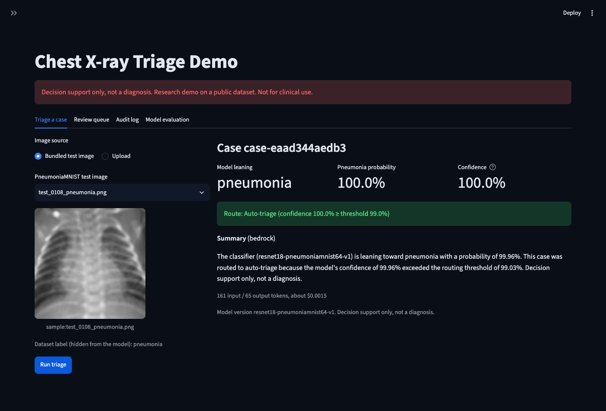
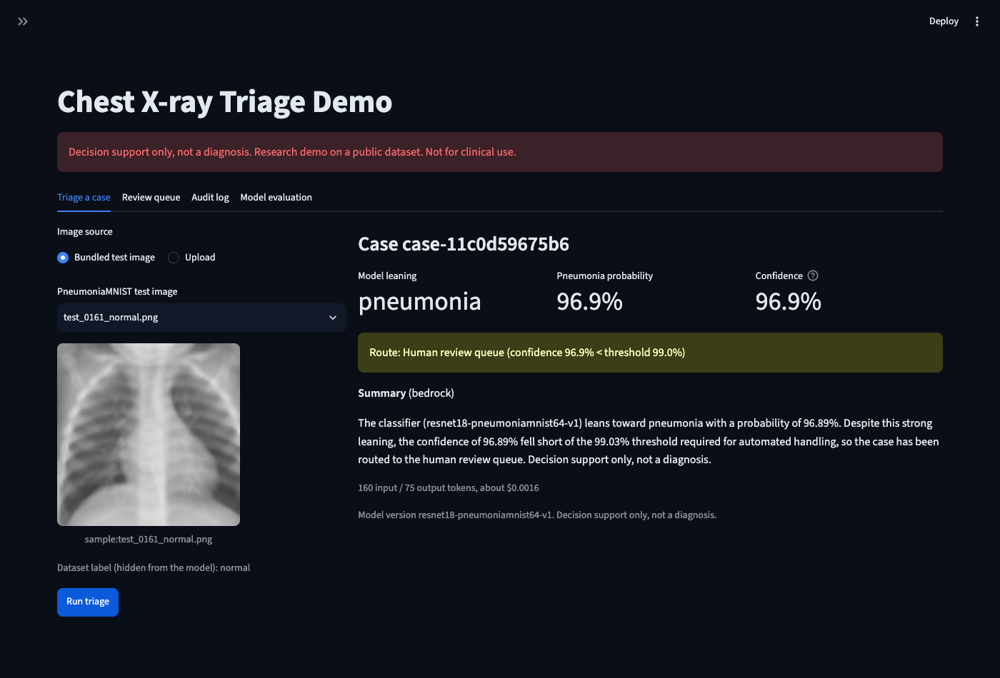
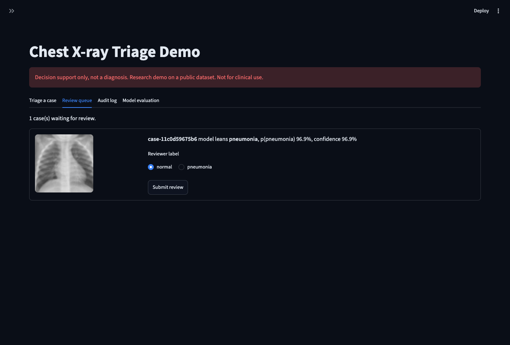
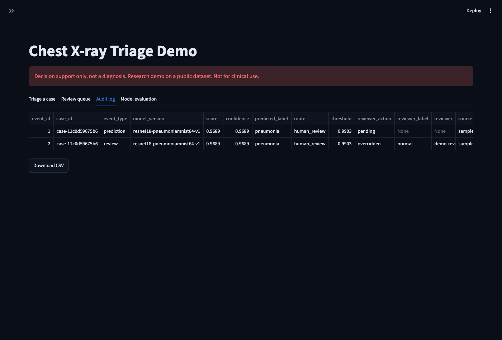
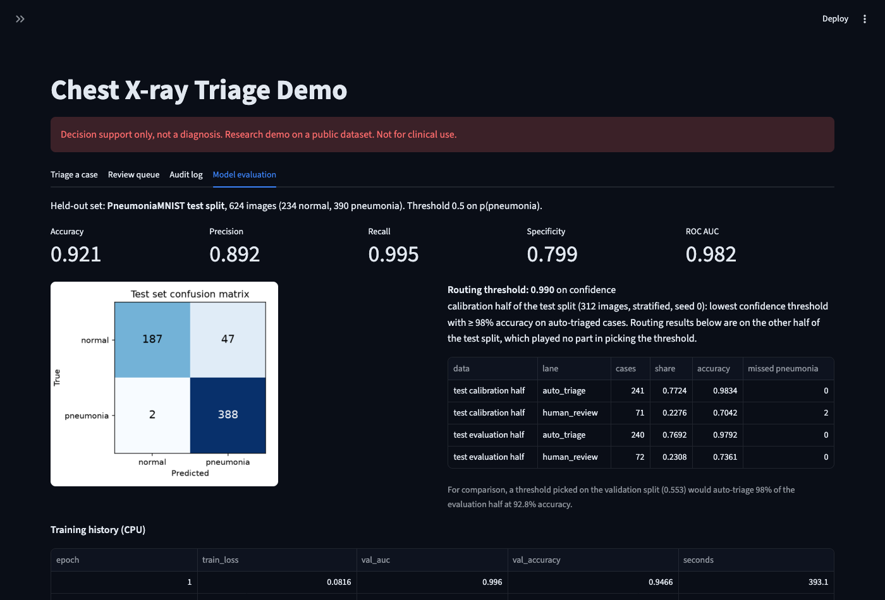
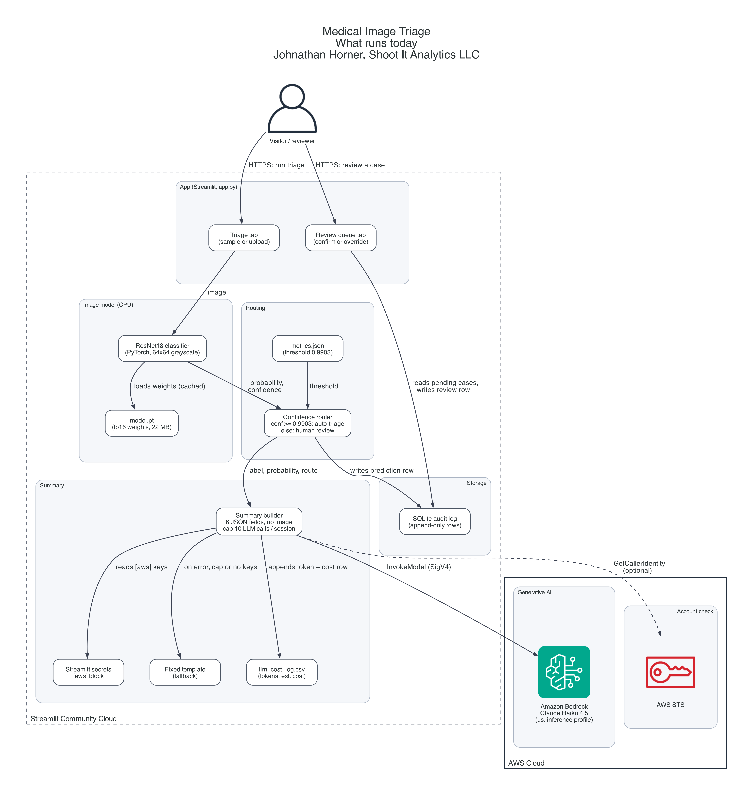

# Medical Image Triage


**Status: Live.** https://medical-image-triage-horner.streamlit.app (checked 2026-11-16: one triage
produced a Bedrock Claude Haiku 4.5 summary; the free Streamlit host puts the app to sleep when idle and
it wakes on the first visit). It also runs locally on a laptop CPU. **Decision support only, not a diagnosis.**

Independent reference project by Shoot It Analytics LLC. Built with public or synthetic data.

## What it does

1. Scores a chest X-ray with a small fine-tuned image model and returns the probability of pneumonia
   plus a confidence score.
2. Routes the case by confidence. Cases at or above a measured threshold go to auto-triage. The rest
   go to a human review queue.
3. Writes a two-sentence summary of the model's output. Claude on Amazon Bedrock writes it when
   enabled; otherwise a fixed template does. The LLM only sees the model's numbers and route,
   never the image.
4. Labels every result "Decision support only, not a diagnosis."
5. Logs every prediction and every reviewer decision to an append-only audit log (case ID, model
   version, score, route, reviewer action, time).
6. Shows all of this in a Streamlit app with four tabs: triage a case, review queue, audit log and
   model evaluation.

The model and data are for demonstration. The images are pediatric chest X-rays from a public
research dataset, downsized to 64x64.

## Screenshots

| Auto-triage | Sent to human review |
|---|---|
|  |  |

| Review queue | Audit log |
|---|---|
|  |  |



## Case study

**Medical Image Triage.** Scores chest X-rays with a small image model, auto-triages the cases it is sure about, sends the rest to a person, and logs every step. A Bedrock LLM writes a short note from the model's output only, never from the image.

Status: **Live** · [Live app](https://medical-image-triage-horner.streamlit.app) · [GitHub](https://github.com/johnathan-horner/medical-image-triage) · [Portfolio](https://portfolio.johnathancloudspace.com/#medical-image-triage)

### Real-world problem

Imaging volumes have grown faster than the number of radiologists, and radiologists are leaving practice at over twice the rate of less than 10 years ago ([ACR Bulletin, 2026](https://www.acr.org/Clinical-Resources/Publications-and-Research/ACR-Bulletin/2026/radiologist-shortage-work-force-update)). A triage aid helps only if it knows which cases it can sort on its own, sends the rest to a person, and leaves a record of every decision.

### Why I built it

I wanted to see whether a small image model trained on a laptop CPU could split X-rays into a confident lane with no missed pneumonia and a review lane for people, and whether an LLM could add a readable note without ever seeing the image.

### Version 1

The first version was a design for a TensorFlow EfficientNetB0 model on a SageMaker endpoint behind API Gateway, Cognito, Lambda and DynamoDB, described as production-grade, while its app ran on mock data. I rebuilt it in October 2026 as a pipeline that actually runs: a small model trained on a laptop CPU on public data, measured on the official test split, with a human review queue and an audit log.

### Key decisions

- **Pick the routing threshold on half of the test split and report on the other half.** Tuning on half the test set gives honest routing numbers, at the cost of resting them on 312 images.
- **The LLM sees six numbers, never the image.** Claude Haiku 4.5 gets the label, probability, confidence, threshold, route and model version and writes two sentences. A fixed template takes over on any error, refusal, missing key or after 10 calls per session. The note adds wording, not information, which is the point: the LLM is not allowed to make clinical claims.
- **A small ResNet18 at 64x64, trained on CPU, with the weights in the repo.** The app, tests and CI run with no GPU and no dataset download. The tradeoff is low resolution and pediatric data from one center.
- **An append-only audit log in SQLite.** Every prediction and every reviewer decision is a new row, and a case's state is its latest row. It is simple to inspect and test, but it is one file shared by all visitors, with no sign-in.

### Architecture



A visitor picks or uploads an X-ray in the Streamlit app. The ResNet18 model scores it, the router compares its confidence with 0.9903 and either auto-triages the case or puts it in the review queue, and each step is written to the audit log. The summary step sends only the six output fields to Claude Haiku 4.5 on Amazon Bedrock through the US cross-Region inference profile, or uses the fixed template.

### Governance and safety

- Confidence gate: anything below 0.9903 confidence goes to a human review queue, where a reviewer confirms or overrides.
- Append-only audit log of every prediction and review, viewable and downloadable as CSV.
- The LLM gets six output fields and never the image; its instructions forbid findings, diagnoses and treatment advice.
- Template fallback on any error or refusal, and a cap of 10 LLM calls per browser session.
- Every result carries "Decision support only, not a diagnosis"; tokens and estimated cost are logged per call.
- Secrets come only from the host's secret store, and CI scans the full git history for leaked keys.

### Results

- PneumoniaMNIST test split, 624 images: 92.1% accuracy, 99.5% pneumonia recall, 79.9% specificity, ROC AUC 0.982.
- Routing, on the half of the test split not used to pick the threshold (312 images): 76.9% auto-triaged at 97.9% accuracy with zero missed pneumonia; 23.1% go to review.
- Live check on 2026-11-16: one Bedrock summary, 157 input and 49 output tokens, about $0.0004.
- 23 automated tests in CI.

### What I got wrong

- **I documented the target design before the pipeline existed.** The first version described a full AWS deployment while the app ran on mock data. The rebuild started from a model I could train and measure.
- **The validation split was too easy.** A threshold picked on validation auto-triaged 98% of cases at only 92.8% accuracy on test, so the threshold is now picked on half of the test split and reported on the other half.
- **Old code outlived the rebuild.** A compiled file from the first version stayed in the repo after the rebuild, with claims the new code does not make. It was deleted in November 2026.
- **The audit log lives on the free host's disk.** It is shared by every visitor and resets when the app restarts, which is fine for a reference app and not for any real use.

### Constraints

- Public research data only (PneumoniaMNIST, CC BY 4.0); never used with patients.
- Trained on a laptop CPU with no GPU; the 22 MB model file ships in the repo.
- Hosted on the free Streamlit tier, which has no IAM role, so the Bedrock key comes from the host's secret store.
- The LLM sees only six output fields and makes at most 10 calls per browser session.
- Every result is decision support only, not a diagnosis.

### Limits

Built on public research data (PneumoniaMNIST: pediatric X-rays from one center at 64x64), never used with patients, not a medical device and not reviewed by a regulator. Specificity is 79.9%, so some normal X-rays get flagged.

### What I'd do in a real deployment

Train and validate on full-resolution images from the target hospitals with subgroup checks, run it in the hospital's own AWS account with sign-in, a durable audit store and role-based review, and go through clinical validation and regulatory review before any clinical use.

### Sources

- [ACR Bulletin: The Radiologist Shortage, a Workforce Update from HPI (2026)](https://www.acr.org/Clinical-Resources/Publications-and-Research/ACR-Bulletin/2026/radiologist-shortage-work-force-update)
- [Live app](https://medical-image-triage-horner.streamlit.app)
- [GitHub](https://github.com/johnathan-horner/medical-image-triage)
- [Portfolio](https://portfolio.johnathancloudspace.com/#medical-image-triage)

Built by Johnathan Horner, Shoot It Analytics LLC

## Architecture

The architecture diagram and how it works are in the [Case study](#architecture) above.

## How to run

Python 3.9 to 3.13 (CI uses 3.11). On Linux, requirements.txt installs CPU-only PyTorch 2.6; on macOS it pins PyTorch 2.2.2, the last version with Intel Mac wheels.

```bash
python -m venv .venv && source .venv/bin/activate
pip install -r requirements-dev.txt
streamlit run app.py
pytest
```

LLM summaries (optional). On Streamlit Cloud, or locally in `.streamlit/secrets.toml` (never commit
it), add a key that may only call Claude Haiku 4.5:

```toml
[aws]
access_key_id = "YOUR_ACCESS_KEY_ID"
secret_access_key = "YOUR_SECRET_ACCESS_KEY"
region = "us-east-1"
```

Or use your local AWS credentials:

```bash
export TRIAGE_USE_BEDROCK=1
export EXPECTED_AWS_ACCOUNT=123456789012   # optional: refuse to call AWS from any other account
export TRIAGE_BEDROCK_MODEL=us.anthropic.claude-haiku-4-5-20251001-v1:0   # default
streamlit run app.py
```

Without credentials the toggle is off and a fixed template writes every summary. A live check on
2026-11-16 used 157 input and 49 output tokens, about USD 0.0004 for one summary. Calls are
logged to `llm_cost_log.csv`; the app caps LLM summaries at 10 per browser session.

Retrain and re-evaluate (downloads PneumoniaMNIST, about 20 MB; took 34 minutes on a 2-core laptop):

```bash
pip install -r requirements-train.txt
python -m triage.train --epochs 6
python -m triage.model_card
```

## Measured results

**How measured.** `python -m triage.train --epochs 6` then `--eval-only`: fine-tuned on the official
train split (4,708 images), best epoch chosen on the validation split (524 images), evaluated once on
the official test split. The routing threshold was picked on a stratified half of the test split
(seed 0) and routing results are reported on the other half.

Held-out set: PneumoniaMNIST official test split, 624 images (234 normal, 390 pneumonia).
Full details are in [MODEL_CARD.md](MODEL_CARD.md) and `artifacts/metrics.json`.

| Metric | Value |
|---|---|
| Accuracy | 0.921 |
| Precision (pneumonia) | 0.892 |
| Recall (pneumonia) | 0.995 |
| Specificity | 0.799 |
| ROC AUC | 0.982 |

Confusion matrix (rows are the truth): normal 187 correct, 47 called pneumonia; pneumonia 388
correct, 2 called normal.

Routing: the threshold (0.990) was picked on a stratified half of the test split as the lowest
confidence with at least 98% accuracy on auto-triaged cases. On the other half, which played no
part in picking it:

| Lane | Share of cases | Accuracy | Missed pneumonia |
|---|---|---|---|
| Auto-triage | 76.9% | 97.9% | 0 |
| Human review | 23.1% | 73.6% | 0 |

A threshold picked on the validation split instead would have been 0.553 and auto-triaged 98% of
cases at 92.8% accuracy, because PneumoniaMNIST's validation split is easier than its test split.

Tests: 23 pytest tests (routing, audit log, summary with a fake Bedrock client, model inference on
the bundled images, and a Streamlit UI run). CI also scans the full git history with gitleaks.

## Limits

- 64x64 images from one pediatric center. Results do not carry over to adults, other hospitals or
  full-resolution images.
- The model is overconfident on some normal X-rays: 47 of 234 normal test images were called
  pneumonia. With the routing threshold, 38 of those 47 go to review and 9 are auto-triaged.
- No probability calibration and no subgroup analysis (the dataset has no demographic fields).
- The audit log is a local SQLite file and the reviewer name is free text.

## Data and licenses

- PneumoniaMNIST (MedMNIST v2), CC BY 4.0. Source images from Kermany et al., Cell 2018, CC BY 4.0.
  Attribution in [samples/README.md](samples/README.md).
- ImageNet-pretrained ResNet18 weights from torchvision.
- Code: MIT, see [LICENSE](LICENSE).

## What's next

- Probability calibration (temperature scaling) so confidence is closer to real accuracy.
- Higher resolution input (128 or 224) and a comparison against the 64x64 model.
- Reviewer identity from a login instead of a free-text name.
- A container image for hosts other than Streamlit Community Cloud, once the above is done.
