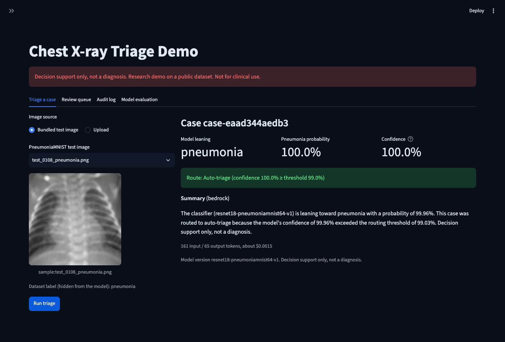
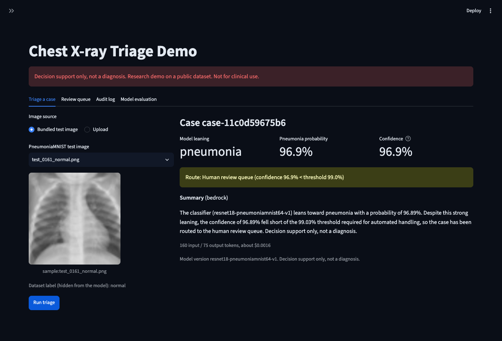
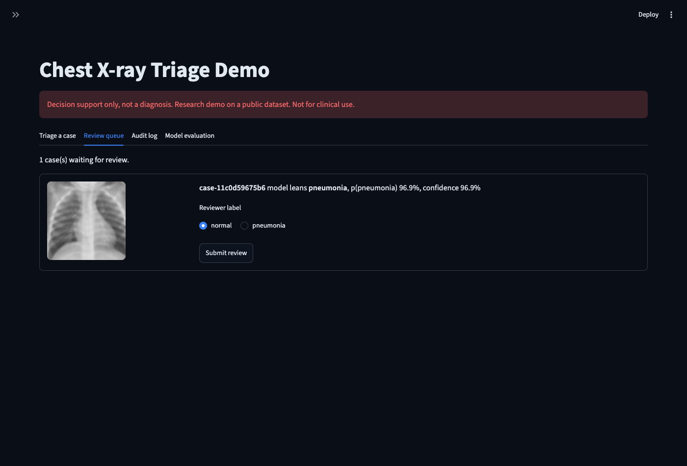
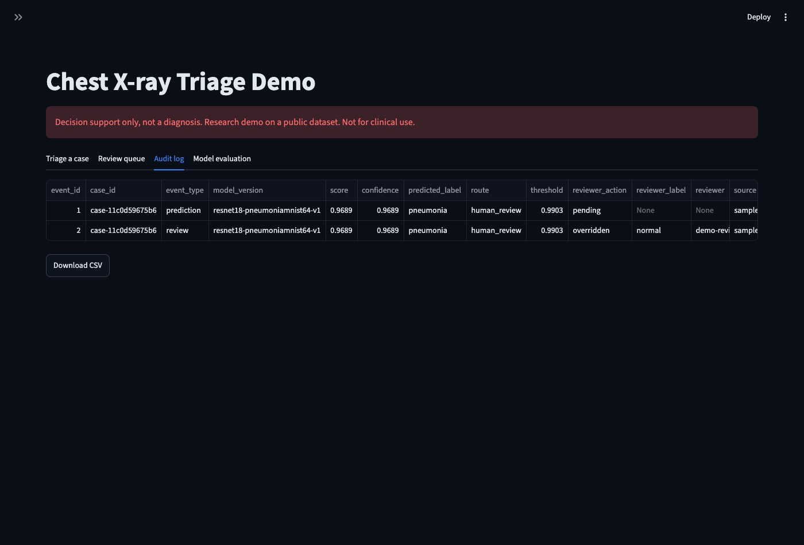
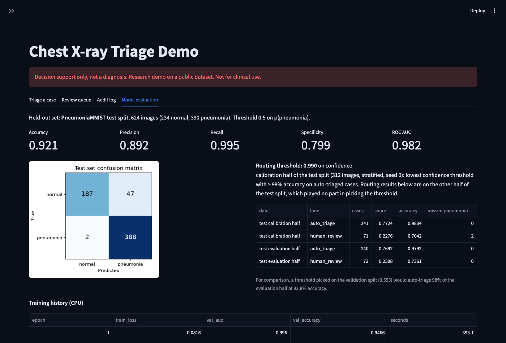
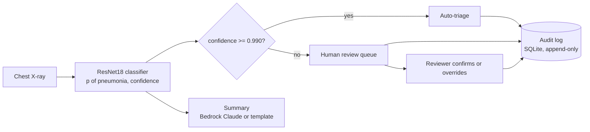

# Chest X-ray Triage Demo


**Status: In progress.** The model, routing, LLM summary, audit log and Streamlit app run locally
today on a laptop CPU. There is no hosted demo of this version. **Decision support only, not a diagnosis.**

Independent reference project by Shoot It Analytics LLC. Built with public or synthetic data.

## What it does

1. Scores a chest X-ray with a small fine-tuned image model and returns the probability of pneumonia
   plus a confidence score.
2. Routes the case by confidence. Cases at or above a measured threshold go to auto-triage. The rest
   go to a human review queue.
3. Writes a two-sentence summary of the model's output. Claude on Amazon Bedrock writes it when
   enabled; otherwise a fixed template does. The LLM only sees the model's numbers and route,
   never the image.
4. Labels every result "Decision support only, not a diagnosis."
5. Logs every prediction and every reviewer decision to an append-only audit log (case ID, model
   version, score, route, reviewer action, time).
6. Shows all of this in a Streamlit app with four tabs: triage a case, review queue, audit log and
   model evaluation.

The model and data are for demonstration. The images are pediatric chest X-rays from a public
research dataset, downsized to 64x64.

## Screenshots

| Auto-triage | Sent to human review |
|---|---|
|  |  |

| Review queue | Audit log |
|---|---|
|  |  |



## Why I built this

**The problem.** Radiology departments read more chest X-rays than they have time for, and urgent
studies can wait in the same queue as routine ones. Image models can help sort the worklist, but a
model that is confidently wrong is dangerous, so any triage aid has to know when to hand a case to a
person and has to leave a record of what it did.

**What I set out to prove.** Whether a small image model trained on a laptop CPU can split chest
X-rays into cases it can sort on its own with high accuracy and cases that need a person, with every
step logged and every result clearly labeled as decision support.

**Key design decisions**
- **Data:** PneumoniaMNIST (public, CC BY 4.0), pediatric chest X-rays at 64x64. Small enough to
  train on a CPU in about half an hour.
- **Model:** ResNet18 pretrained on ImageNet and fine-tuned, a well-understood baseline, not a novel
  architecture.
- **Threshold:** picked on one half of the test split and reported on the other half. A threshold
  picked on the validation split failed, because this dataset's validation split is easier than its
  test split.
- **Guardrails:** the LLM sees only the model's numbers and route, never the image; a template takes
  over if Bedrock is unavailable; every result carries "Decision support only, not a diagnosis.";
  the audit log is append-only.
- **Cost:** CPU training and about $0.0015 per LLM summary on Claude Sonnet 4.6 through Bedrock.

**Results.** On the held-out test split: 92.1% accuracy, 99.5% recall for pneumonia, 79.9%
specificity. With the routing threshold, 76.9% of cases were auto-triaged at 97.9% accuracy with no
missed pneumonia, and the rest went to a person (details below).

**Limits.** Public research data only; never used with real patients. Not a medical device, not
cleared or certified for clinical use, and not a diagnosis.

**What I'd do next in a real deployment.** Validate on images from the target hospitals and
equipment at full resolution, calibrate probabilities, run a prospective silent trial against
radiologist reads, add reviewer authentication, and go through the regulatory path before any
clinical use.

## Architecture



| Piece | File | Notes |
|---|---|---|
| Model | `triage/model.py` | torchvision ResNet18, ImageNet weights, one output logit |
| Training and evaluation | `triage/train.py` | CPU only, writes `artifacts/` |
| Routing | `triage/routing.py` | threshold choice and per-lane report |
| Audit log | `triage/audit.py` | every event is a new row; nothing is updated in place |
| Summary | `triage/summary.py` | Bedrock call, template fallback, per-call cost log |
| App | `app.py` | Streamlit |

The trained weights (`artifacts/model.pt`, 22 MB) and 32 test images (`samples/`) are in the repo,
so the app and tests run without downloading the dataset.

## How to run

Python 3.11 to 3.13. On Linux, requirements.txt installs CPU-only PyTorch 2.6; on macOS it pins PyTorch 2.2.2, the last version with Intel Mac wheels.

```bash
python -m venv .venv && source .venv/bin/activate
pip install -r requirements-dev.txt
streamlit run app.py
pytest
```

LLM summaries (optional, needs AWS credentials with Bedrock access):

```bash
export TRIAGE_USE_BEDROCK=1
export EXPECTED_AWS_ACCOUNT=123456789012   # optional: refuse to call AWS from any other account
export TRIAGE_BEDROCK_MODEL=us.anthropic.claude-sonnet-4-6   # default
streamlit run app.py
```

Each summary uses about 160 input and 70 output tokens, roughly $0.0015 per case. Calls are logged
to `llm_cost_log.csv`.

Retrain and re-evaluate (downloads PneumoniaMNIST, about 20 MB; took 34 minutes on a 2-core laptop):

```bash
pip install -r requirements-train.txt
python -m triage.train --epochs 6
python -m triage.model_card
```

## Measured results

**How measured.** `python -m triage.train --epochs 6` then `--eval-only`: fine-tuned on the official
train split (4,708 images), best epoch chosen on the validation split (524 images), evaluated once on
the official test split. The routing threshold was picked on a stratified half of the test split
(seed 0) and routing results are reported on the other half.

Held-out set: PneumoniaMNIST official test split, 624 images (234 normal, 390 pneumonia).
Full details are in [MODEL_CARD.md](MODEL_CARD.md) and `artifacts/metrics.json`.

| Metric | Value |
|---|---|
| Accuracy | 0.921 |
| Precision (pneumonia) | 0.892 |
| Recall (pneumonia) | 0.995 |
| Specificity | 0.799 |
| ROC AUC | 0.982 |

Confusion matrix (rows are the truth): normal 187 correct, 47 called pneumonia; pneumonia 388
correct, 2 called normal.

Routing: the threshold (0.990) was picked on a stratified half of the test split as the lowest
confidence with at least 98% accuracy on auto-triaged cases. On the other half, which played no
part in picking it:

| Lane | Share of cases | Accuracy | Missed pneumonia |
|---|---|---|---|
| Auto-triage | 76.9% | 97.9% | 0 |
| Human review | 23.1% | 73.6% | 0 |

A threshold picked on the validation split instead would have been 0.553 and auto-triaged 98% of
cases at 92.8% accuracy, because PneumoniaMNIST's validation split is easier than its test split.

Tests: 20 pytest tests (routing, audit log, summary with a fake Bedrock client, model inference on
the bundled images, and a Streamlit UI run). CI also scans the full git history with gitleaks.

## Limits

- 64x64 images from one pediatric center. Results do not carry over to adults, other hospitals or
  full-resolution images.
- The model is overconfident on some normal X-rays: 47 of 234 normal test images were called
  pneumonia. With the routing threshold, 38 of those 47 go to review and 9 are auto-triaged.
- No probability calibration and no subgroup analysis (the dataset has no demographic fields).
- The audit log is a local SQLite file and the reviewer name is free text.

## Data and licenses

- PneumoniaMNIST (MedMNIST v2), CC BY 4.0. Source images from Kermany et al., Cell 2018, CC BY 4.0.
  Attribution in [samples/README.md](samples/README.md).
- ImageNet-pretrained ResNet18 weights from torchvision.
- Code: MIT, see [LICENSE](LICENSE).

## What's next

- Probability calibration (temperature scaling) so confidence is closer to real accuracy.
- Higher resolution input (128 or 224) and a comparison against the 64x64 model.
- Reviewer identity from a login instead of a free-text name.
- A container image and a deploy target, once the above is done.
